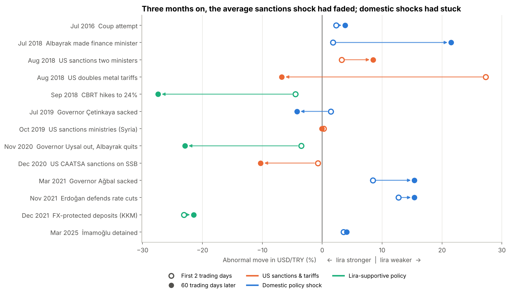
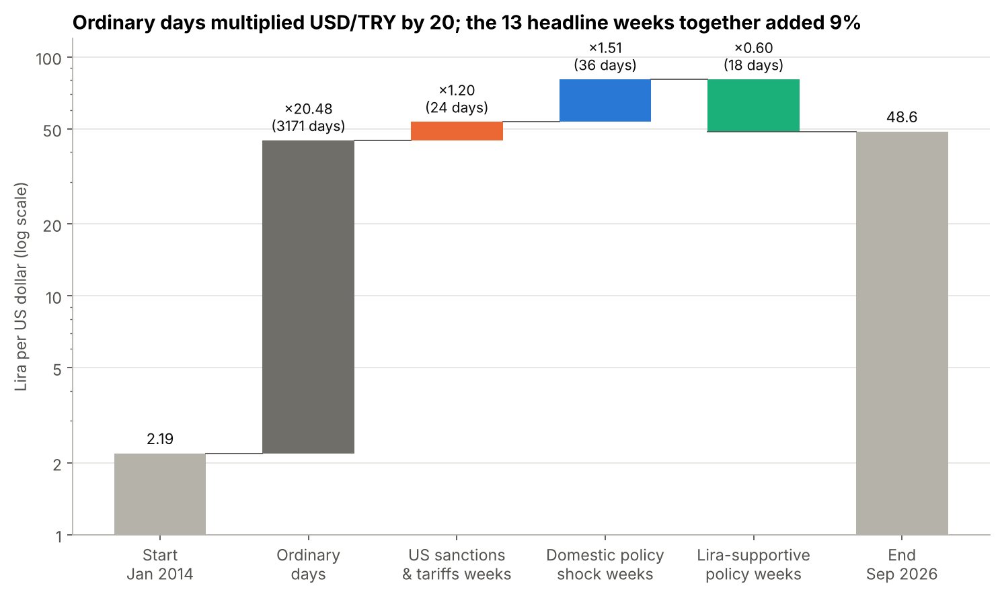
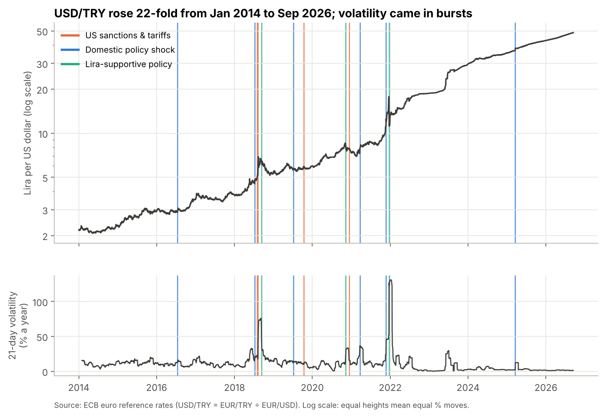
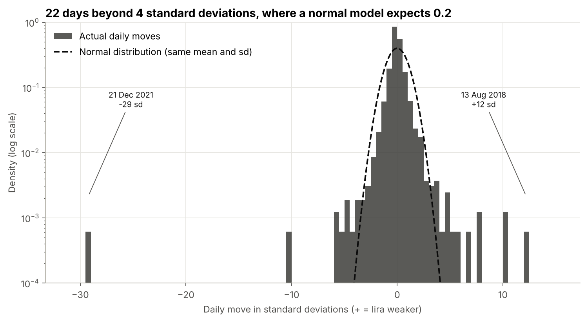
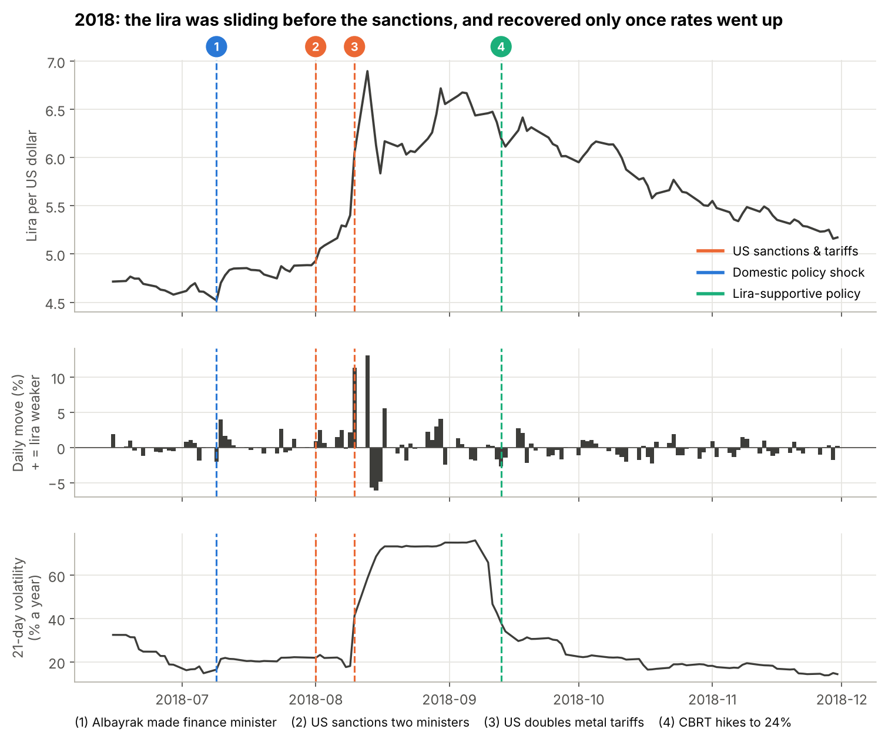
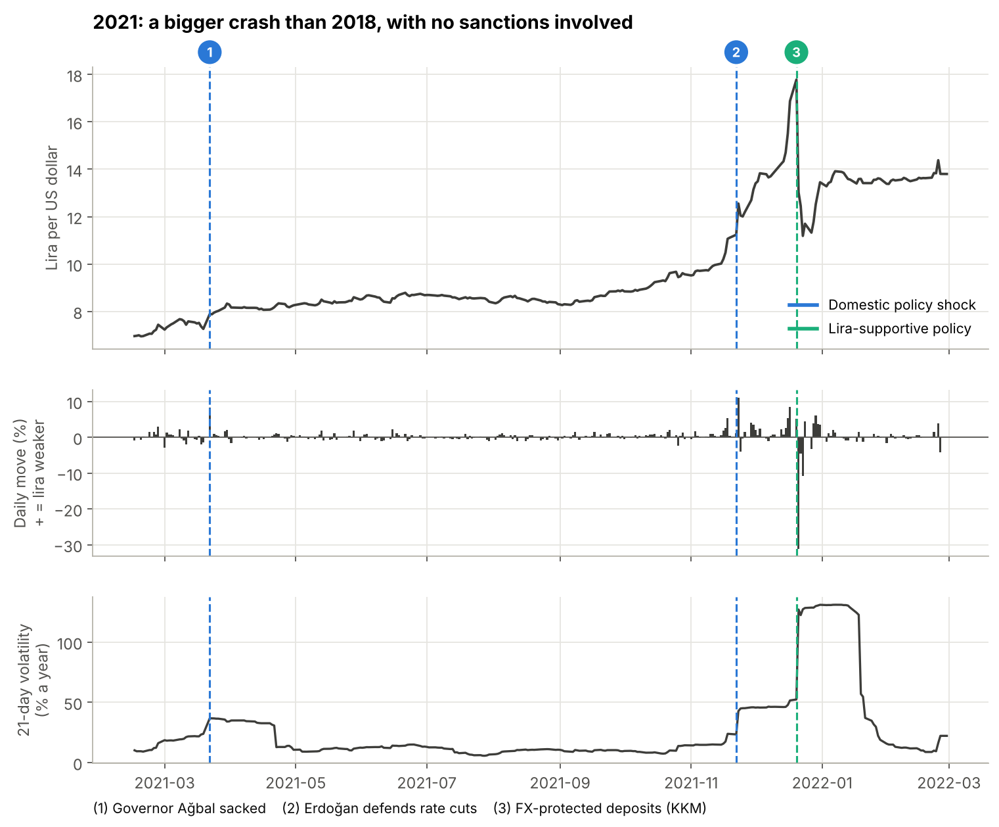

# Do Sanctions Crash Currencies? The Turkish Lira, 2014 to 2026

**An event study of 13 sanctions, tariff and policy shocks to the Turkish lira, built to understand the 2026 collapse of the Iranian rial.**

[](https://colab.research.google.com/github/IbrahimMansaray1/lira-sanctions-analysis/blob/main/lira_sanctions_analysis.ipynb)

## The question

In early 2026 the Iranian rial collapsed, and the news blamed US sanctions. There is no reliable public daily data for the rial (Iran runs several exchange rates at once, and the one most people pay is an informal street rate), so I studied the closest liquid analogue: the Turkish lira, which was hit by US sanctions and tariffs in 2018, 2019 and 2020, and by a series of home-grown policy shocks in between.

Two questions:

1. **Do sanctions crash currencies?**
2. **Is the crash as bad as the headlines make it look?**

## Findings

| | |
|---|---|
| **Sanctions were triggers, not causes.** | 3 of the 4 US sanctions or tariff actions moved the lira by less than 5% over two days. The exception (tariffs doubled on 10 August 2018, +27% in USD/TRY over two days) hit a currency that was already sliding, and was 94% reversed three months later, after the central bank raised rates to 24%. |
| **Home-grown policy shocks did the lasting damage.** | Three months after each event, US sanctions had left an average abnormal move of **-2%** in USD/TRY; domestic policy shocks (sacked central bank governors, rate cuts with inflation near 20%) had left **+9%**. Suggestive rather than conclusive with 10 events (Welch p = 0.09). |
| **The grind beat the crashes.** | USD/TRY rose **22-fold** from Jan 2014 to Sep 2026 (the lira lost **95.5%** of its dollar value). Ordinary days multiplied USD/TRY by about 20; the 13 headline weeks together added only 9%. |
| **Headlines overstate the damage; normal models understate the risk.** | The lira had **22 days** beyond four standard deviations, where a normal distribution expects **0.2**. Its biggest one-day move was USD/TRY *falling* 27% (a 36% gain for the lira) the day after the state promised to protect lira savings from depreciation (21 Dec 2021): a 29-standard-deviation event. |



Each row is one event. The open circle is the abnormal move in USD/TRY over the first two trading days; the filled circle is the abnormal move 60 trading days later. US sanctions (orange) mostly ended near or below zero; domestic policy shocks (blue) mostly stayed above it.



Because log returns add up, the total move can be split exactly into event weeks and ordinary days. Strip out every headline week and USD/TRY still rises from 2.19 to 44.8, against an actual 48.6.

## More charts

| | |
|---|---|
|  |  |
|  |  |

An interactive version of the main chart (hover over each event) is in [`usdtry_interactive.html`](usdtry_interactive.html); download it and open it in a browser.

## Method

* **Data.** Daily USD/TRY from the [ECB's euro reference rates](https://www.ecb.europa.eu/stats/eurofxref) (EUR/TRY divided by EUR/USD), 2 January 2014 to 14 September 2026, 3,250 trading days. Cross-checked against Yahoo Finance `TRY=X` in the notebook. The ECB was chosen over Yahoo because it is official, stable and reproducible; Yahoo's FX volume is always zero and its daily cut-off is undocumented.
* **Returns and volatility.** Log returns; 21-day realised volatility annualised with √252; EWMA volatility (λ = 0.94) to measure how quickly panic fades.
* **Event catalogue.** 13 events chosen from the news record before looking at the data, in three groups: US sanctions & tariffs (4), domestic policy shocks (6), and lira-supportive policy (3) as a control. Dates and sources are in the notebook and in `event_study.csv`.
* **Event study.** Normal behaviour (mean and volatility of daily returns) estimated over trading days -250 to -21; abnormal returns cumulated over days 0 to 1, 0 to 5 and 0 to 60; z-scores relative to normal volatility; Welch t-test and Mann-Whitney test between groups.
* **Decomposition.** Total log change split into event weeks and ordinary days, shown as multipliers.
* **Fat tails.** Observed versus normal-distribution frequency of 3 to 10 standard deviation days.
* **Appendix.** A full-sample GARCH(1,1) gives α + β ≈ 1, a known artefact of regime shifts, which is why panic decay is measured event by event instead.

## Run it

Click the Colab badge above, then **Runtime > Run all**. Or locally:

```bash
pip install -r requirements.txt
jupyter notebook lira_sanctions_analysis.ipynb
```

The notebook downloads the ECB data itself. A snapshot, `ecb_usdtry.csv`, is included: to run offline, put it in a folder called `data` next to the notebook. The end date is fixed at 14 September 2026 so every number above can be reproduced exactly.

## Repository

```
lira_sanctions_analysis.ipynb   the full analysis, with commentary
ecb_usdtry.csv                  ECB reference rates snapshot (EUR/USD, EUR/TRY, USD/TRY)
01_ to 06_ *.png                charts used above
usdtry_interactive.html         interactive version of the main chart
event_study.csv                 per-event results
decomposition.csv               crash-versus-grind decomposition
requirements.txt
```

## Limitations and next steps

The sample is small (4 sanctions events), some event windows overlap (August to September 2018; November to December 2021), the constant-mean model ignores changing drift, the ECB fixing is one snapshot a day, and the analysis looks at the spot rate only, ignoring the high interest earned on lira deposits. Next steps: apply the same code to the Russian rouble around the April 2018 US sanctions, add carry, run a placebo test on random dates, and bring in market-implied measures (FX options volatility, sovereign CDS).

## Project history

Version 1 (Colab) charted daily returns and rolling volatility around two events. Version 2 fixes a volatility calculation that used price levels instead of returns, switches to official ECB data, and adds the event catalogue, event study, decomposition and fat-tail analysis.

## Author

**Ibrahim Mansaray**, BSc Mathematics and Physics, University of Warwick. Interested in macro and emerging-markets trading.
